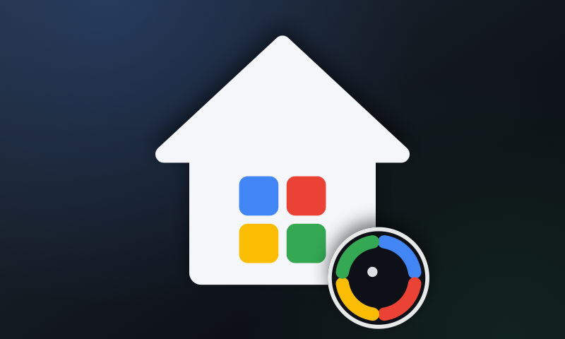

# HomeBoard



An Apple TV dashboard for the house: weather, the kids' school week, HomeKit doors, climate, lights
and cameras, and a Claude briefing you can ask questions.

| Tab | What it shows |
|---|---|
| **Home** | Clock and current weather, Claude's briefing with alerts, then hourly and 5-day weather, today at school (tomorrow after 3 pm), and the house |
| **School** | SchoolBoard's full week and month board, shared from `../SchoolBoard` |
| **Cameras** | HomeKit camera snapshots, refreshed every 10 s. Select one for live video |
| **Ask** | Ask Claude about school, home or the weather. Select the box and hold the Siri button to dictate |

Press **Menu** on the remote to reach the tabs. After 5 idle minutes the board returns to Home, and it
dims from 9 pm to 6 am.

## The house

HomeBoard reads the HomeKit home that the Apple TV's iCloud account belongs to. The first launch asks for
permission. If you missed the prompt, turn it on in Settings → Apps → HomeBoard.

* **Doors:** select a locked door to unlock it, or a closed garage to open it. Both ask for confirmation
  first. Select an unlocked or open one to lock or close it straight away.
* **Climate:** thermostats and temperature sensors. Use − / + to change a thermostat's target by 1°.
* **Lights:** the lights that are on. Select one to turn it off. Scenes run with one press.

## Alerts

The board raises safety alerts itself, so they don't depend on the network or the API:

* the garage left open (urgent after 15 minutes or at night)
* a door unlocked at night, or for over an hour during the day
* a jammed lock or a door that isn't responding
* missing schoolwork

Claude adds up to three more each time it writes the briefing, such as "Umbrellas for school pickup".
Claude only reads the board. It can't lock, open or switch anything.

## Setup

```bash
cp HomeBoard/HomeConfig.example.json HomeBoard/HomeConfig.json   # gitignored
```

In `HomeConfig.json`:

| Key | |
|---|---|
| `location` | Name, latitude and longitude for the weather (Open-Meteo, no key needed) |
| `units` | `"fahrenheit"` or `"celsius"` |
| `homeName` | Which HomeKit home to show if you have several (otherwise the first one) |
| `hiddenAccessories` | Accessory names to leave off the board |
| `anthropicAPIKey` | Key from platform.claude.com. It's stored inside the app on the TV, so use a key with a monthly spend limit |
| `model`, `effort` | Default `claude-opus-5-5` at `low` effort |
| `briefingMinutes` | How often the briefing is rewritten between 6 am and 10 pm (default 60) |

The school feeds and kids come from SchoolBoard's `BoardConfig.json`. See `../SchoolBoard/README.md`.

## Build & install

HomeBoard builds its `BoardCore` package and TV views from [SchoolBoard](https://github.com/k-sangili/school-board), so clone both side by side:

```bash
git clone https://github.com/k-sangili/school-board SchoolBoard
git clone https://github.com/k-sangili/home-board HomeBoard
cd HomeBoard
export DEVELOPMENT_TEAM=XXXXXXXXXX
export BUNDLE_ID=com.yourname.homeboard
xcodegen generate
open HomeBoard.xcodeproj      # pick the Apple TV, ⌘R
```

The HomeKit capability is added to the App ID automatically when Xcode signs the app.
Launch with `-demo` to see a sample home, weather and briefing.

## Code

| Path | What |
|---|---|
| `HomeBoard/Home/HomeStore.swift` | HomeKit → doors, climate, lights, scenes, cameras. Also handles locking, the thermostat and scenes |
| `HomeBoard/Weather/WeatherStore.swift` | Open-Meteo forecast and weather codes |
| `HomeBoard/AI/` | `ClaudeClient` (Messages API over URLSession), `Assistant` (briefing, alerts, questions), `AlertRules` |
| `HomeBoard/Views/` | Tabs, dashboard panels, cameras, Ask |
| `tools/make-assets.swift` | Draws the app icon and Top Shelf images in the Quanta Insights palette (`swift tools/make-assets.swift`) |
